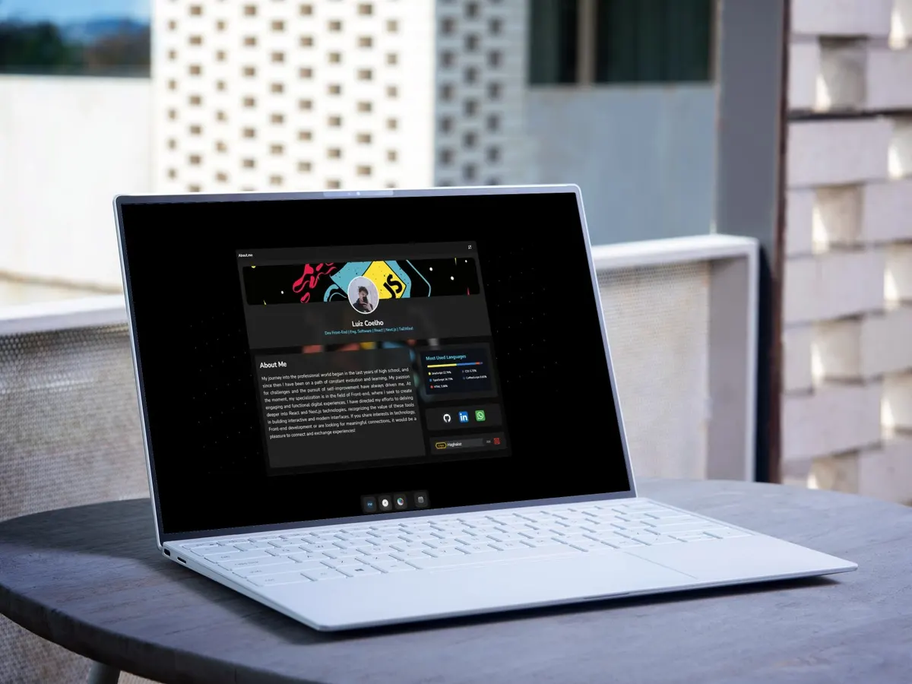

# Luiz Coelho | Portfolio

A portfolio that looks like a desktop. Instead of one long page, every part of my story is an app you open from the dock: who I am, where I worked and studied, what I built, what I know and how to reach me.

<div style="border-radius: 0.5rem; height: 22rem; width: 100%; overflow: hidden; position: relative;">
  
</div>

**Live:** [haghalaz.github.io/portfolio](https://haghalaz.github.io/portfolio/)

## The apps

Each app is one chapter, in reading order:

| App | What it tells | Metaphor |
| --- | --- | --- |
| **Contacts** | Who I am: bio, stack, where I work and study, recommendations | An instant-messenger profile, with presence, a personal message and a buddy list |
| **Calendar** | Career and education | Each company or school is a calendar, each role an event on a yearly timeline, with hover cards |
| **Photos** | Projects | A photo library: grid, full-screen viewer, info panel and favorites |
| **Music** | Skills | Every skill is a song, grouped in albums, with a real player |
| **Mail** | How to reach me | A new message addressed to me, with the real channels as buttons |
| **Settings** | Preferences | Theme, language, wallpaper parallax, demo clip and saved data |

Around the apps: a lock screen (press Enter or swipe up), a menu bar with the clock and a mini player, and a dock with magnification.

## Features

- **Desktop shell:** draggable windows that minimize into their dock icon, stack in focus order and go full screen on phones.
- **Lock screen:** greeting by time of day, swipe-up or Enter to unlock.
- **Menu bar player:** what is playing shows up on top, with previous, play/pause and next on hover.
- **Music player:** shuffle, repeat, seek that applies on release, volume and mute, and per-skill colors.
- **Typing code banner:** the profile banner types a React snippet, makes a few mistakes and fixes them.
- **Internationalization:** English and Portuguese, detected from the browser and remembered.
- **Themes:** light and dark.
- **Saved on the device:** theme, language, favorites, player preferences, settings and the last browsing state, all in `localStorage` (and clearable from Settings).
- **Accessibility:** keyboard navigation, labelled controls, focus management in dialogs and `prefers-reduced-motion` support.
- **Performance:** self-hosted WebP images and SVG icons, lazy-loaded apps, no runtime hotlinking.

### Keyboard

| Key | Action |
| --- | --- |
| `Enter` | Unlock the lock screen |
| `Esc` | Minimize the focused window, or close the project viewer |
| `←` `→` | Previous and next project in the Photos viewer |
| `←` `→` on a slider | Seek or change volume |

## Tech stack

- [React 18](https://react.dev/) and [TypeScript](https://www.typescriptlang.org/)
- [Vite 5](https://vitejs.dev/) and [Tailwind CSS 3](https://tailwindcss.com/)
- [react-spring](https://www.react-spring.dev/) and [use-gesture](https://use-gesture.netlify.app/) for the windows, dock and lock screen
- [Radix UI](https://www.radix-ui.com/) primitives (avatar, slider, tooltip, slot) and `class-variance-authority`
- [i18next](https://www.i18next.com/) and `react-i18next`
- [lucide-react](https://lucide.dev/) for interface icons and [simple-icons](https://simpleicons.org/) for brand logos (pinned to v13, which still includes LinkedIn)

## Getting started

Requires Node.js 18 or newer.

```bash
git clone https://github.com/Haghalaz/portfolio.git
cd portfolio
npm install
npm run dev
```

Then open the address Vite prints (usually `http://localhost:5173/portfolio/`).

| Script | What it does |
| --- | --- |
| `npm run dev` | Dev server, reachable on your network |
| `npm run build` | Type-check with `tsc`, then production build in `dist/` |
| `npm run preview` | Serves the production build locally |
| `npm run lint` | ESLint with zero warnings allowed |

## Project structure

```
src/
  components/
    atoms/        buttons, sliders, switches, icons, chips
    molecules/    menu bar, wallpaper, lock screen, player, code banner, dock pieces
    organisms/    window, toolbar (dock), desktop content
    pages/        one folder per app: contacts, calendar, photos, music, mail, settings
  data/           career, projects, links, tech, testimonials, songs, pages (the dock)
  locale/         en.json and pt.json, grouped by app
  utils/          contexts, hooks, asset helper, storage keys
public/
  assets/         images (WebP), tech icons (SVG), songs and the demo video
```

Path aliases (`@atoms`, `@pages`, `@data`, `@hooks`, `@contexts`, `@utils`...) are declared in `vite.config.ts`.

## Editing the content

Almost everything is data, so most changes do not touch components:

- **Career and education:** `src/data/career.ts`. A role can have `periods` for breaks, as the degree does.
- **Projects:** `src/data/projects.ts`. Cover images go in `public/assets/images/projects/` as 4:3 WebP (1200 x 900). A missing cover falls back to a placeholder with the initials.
- **Recommendations:** `src/data/testimonials.ts`. Only real ones, kept in the language they were written.
- **Links and email:** `src/data/links.ts`.
- **Skills (songs):** `src/data/songs.ts`.
- **Technologies shown on projects:** `src/data/tech.ts`.
- **Texts:** `src/locale/en.json` and `src/locale/pt.json`. Both files have the same keys in the same order, grouped by app.
- **Dock apps:** `src/data/pages.ts`.

When a feature saves something in `localStorage`, add its key to `src/utils/storageKeys.ts` so the "clear saved data" button wipes it too.

Files in `public/` should be referenced with the `asset()` helper (`src/utils/asset.ts`), because the site is served from `/portfolio/`.

## Deploy

Every push to `main` runs the GitHub Actions workflow in `.github/workflows/deploy.yml`: it installs, builds and publishes `dist/` to GitHub Pages. The Vite `base` is `/portfolio/`.

## Contact

- Email: [luizneto0213@gmail.com](mailto:luizneto0213@gmail.com)
- LinkedIn: [Luiz Coelho](https://www.linkedin.com/in/luiz-coelho-neto/)
- GitHub: [Haghalaz](https://github.com/Haghalaz)

Thank you for visiting my portfolio!
